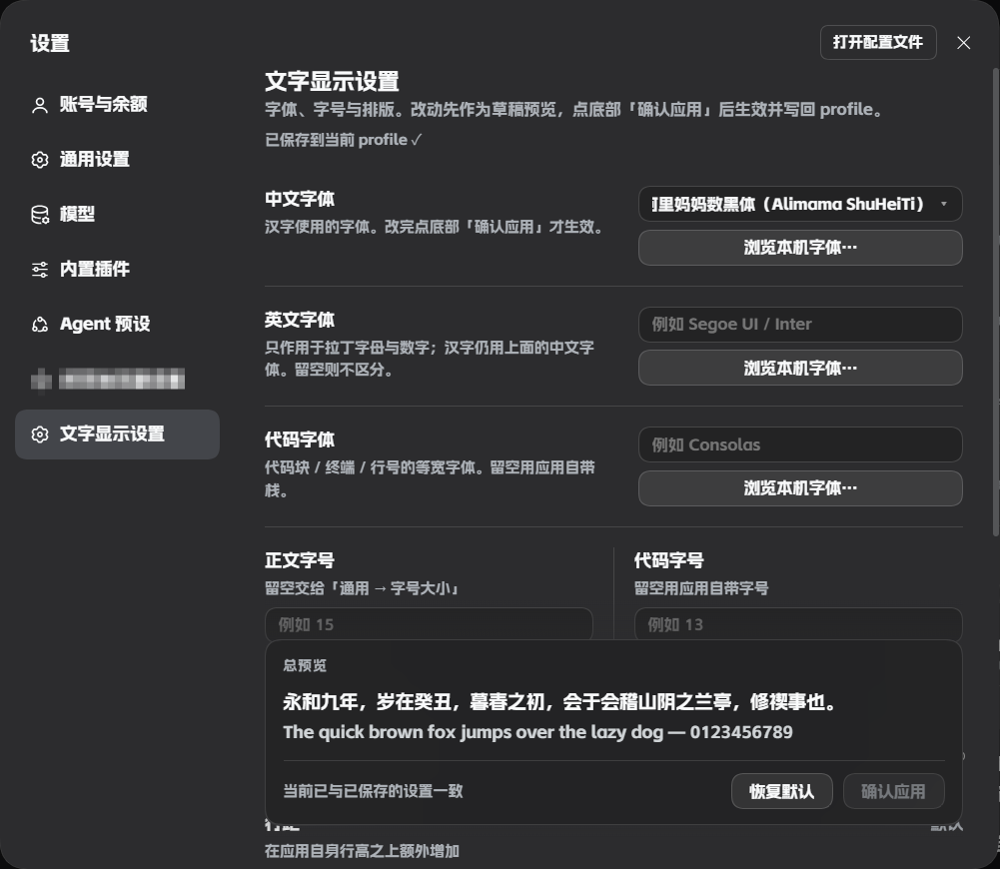

# dsh-font-probe

**给 DeepSeek Harness 的 Web 界面换字体、调排版，全程在设置里点，不动 `app.asar`。**

中英文字体分开设、界面与标题字重可调、字距行距段距首行缩进四根滑块，
改完先在吸底总预览里看准，再一键确认 —— 配置写回 profile，重启不丢。

> **字号不在这里**：官方从 v0.2.1-alpha.2 起已在「设置 → 通用 → 外观」提供
> 正文字号 / 代码字号 / 终端字号。本插件只补官方没有的部分。

[](https://www.npmjs.com/package/dsh-font-probe)
[](./LICENSE)
[](#)
[](./package.json)

> 中文优先。English readers: see [English](#english) at the bottom.

---

## 为什么需要它

DSH 官方已有配色方案、字号（正文字号 / 代码字号 / 终端字号）和字体族输入框，
但**字体只能手输名称**，也没有字重和排版控制。
想换字体，直觉做法是改 `app.asar` 里的 CSS —— 但那是应用本体，
**每次升级都会被覆盖**，而且改坏了很难还原。

这个插件走 Cordis 的客户端插件通道，用公开的 `styles.insert()` 注入样式，
只覆盖 CSS 自定义属性，**不修改任何应用文件**，因此：

- 升级 DSH 不会丢设置
- 卸载插件即完全还原
- 配置存在 profile 里，可携带、可版本控制

## 功能

| | 能力 |
|---|---|
| **中文字体** | 汉字独立设族名。点名称展开预设，其它族走「浏览本机字体…」 |
| **英文字体** | **只作用于拉丁字母与数字**，汉字仍用中文字体。留空则不区分 |
| **代码字体** | 代码块 / 终端 / 行号的等宽字体，同样可浏览本机字体 |
| **界面字重 / 标题字重** | 同一行左右并排。界面字重管 body 与正文段落，标题字重只影响 Markdown 标题；标题留空则跟随界面 |
| **字距** | 滑块 0–3px |
| **行距** | 滑块 0–12px，**在应用自身行高之上叠加**，不是替换 |
| **段距** | 滑块 0–24px，段落之间 |
| **首行缩进** | 滑块 0–4em，随字号缩放 |
| **总预览** | 吸底卡片，字体 / 字重 / 字距 / 行距 / 段距 / 缩进 / 代码样张一起实时预览（含标题样张） |
| **预览可伸缩** | 上缘拖动条调高度（80–560px），标题行可整块隐藏；偏好记在本地 |
| **缺字体可下载** | 展开预设时自动检测本机是否安装，缺的显示「下载」直达官方页 |
| **确认制** | 所有改动先进草稿，点「确认应用」才生效并落盘 |
| **恢复默认** | 一键清空草稿（仍需确认才生效） |

全部设置在 **设置 → 文字显示设置**。

## 截图



深色主题下的完整设置页：中英文字体各自独立、代码字体同样可浏览本机字体，
底部是吸底的总预览与确认栏。（此图为 1.x，已含后来移除的字号栏）

## 两个版本

| 包 | 内容 | 适合谁 |
|---|---|---|
| **`dsh-font-probe`**（本仓库） | 字体族（中/英/代码）+ 字重 + 排版 | 想要**浏览本机字体**、中文英文分开设 |
| **`dsh-font-probe-lite`**（[`lite/`](./lite)） | 只有字重 + 排版 | 已经用官方「外观」管字体和字号，只缺字重与排版 |

两者设置命名空间不同，可以共存：主包管字体，轻量版管字重与排版。

```bash
dsh plugin --profile desktop add dsh-font-probe        # 完整版
dsh plugin --profile desktop add dsh-font-probe-lite   # 轻量版
```

## 中文预设

字体列表里内置了 15 条预设，其中 8 条中文：霞鹜文楷系列（原名 / 屏幕阅读版 / GB）、
月星楷、香萃等粗宋、方正魏碑、方正粗金陵、方正行楷。

一个预设可以匹配**多个真实族名**（中文名、英文名、简体后缀）——只要装了其中一个，
就判定为已安装；写入时会把全部别名一起放进字体栈，由浏览器挑实际装了的那个。

下载链接只挂官方页：霞鹜文楷三款、月星楷、香萃等粗宋都指向各自的 GitHub 仓库
（开源），方正三款指向方正字库官方检索页（商用需授权）。
## 安装

**一条命令，不需要 git**：

```bash
dsh plugin --profile desktop add dsh-font-probe
```

装完**重启应用**（托盘右键 → 退出应用 → 重新打开），
侧栏「设置」里就会出现「文字显示设置」。

> 首次安装后必须重启：插件是双半体（host + client），
> host 半体的配置 schema 要由模块加载器导入一次才生效。

<details>
<summary>其它安装方式</summary>

从 GitHub 源码装（**需要本机有 git**）：

```bash
dsh plugin --profile desktop add github:lohana20061023-29/dsh-font-probe
```

从 Release 的 tarball 装（不需要 git，也不需要 npm 源）：

```bash
dsh plugin --profile desktop add https://github.com/lohana20061023-29/dsh-font-probe/releases/latest/download/dsh-font-probe-1.5.2.tgz
```

从本地目录装（适合改代码调试）：

```bash
dsh plugin --profile desktop add G:/path/to/dsh-font-probe
```

</details>

### 更新与卸载

```bash
dsh plugin --profile desktop update dsh-font-probe
dsh plugin --profile desktop remove dsh-font-probe
```

卸载后样式表随之移除，界面字体立即回到应用默认。

## 用法

1. 打开 **设置 → 文字显示设置**
2. 挑中文字体、英文字体、代码字体，选界面/标题字重，拖四根滑块调排版
3. 盯着底部**总预览**看效果
4. 满意了再点 **确认应用**

没点确认之前，界面、CSS 变量、profile 三者都不会变 —— 可以放心反复试。

## 原理

插件只做两件事：**注入 CSS 自定义属性** 和 **在一个样式表里写少量规则**。

### 字体族

`--dsw-font-family` 是应用正文的字体令牌。插件合成为：

```css
--dsw-font-family: "英文字体", "中文字体", <应用自带栈>;
```

CSS 字体栈**按字符逐个回退**：字母在 `英文字体` 里命中，汉字因为它没有字形而落到
`中文字体`。**顺序反过来就不成立** —— 中文字体通常自带拉丁字形，放前面会让英文字体
永远轮不到。

### 排版（字号交给官方）

| 目标 | 手段 |
|---|---|
| 正文 | 覆盖 `--dsh-content-font-size` |
| 字距 / 行距 / 段距 / 缩进 | 只作用于 `[class*="_markdown"]`，**不碰设置面板自己的文字** |

行距是**叠加**而非替换，所以在官方那里改字号时行高仍会等比变化：

```css
line-height: calc(24px + var(--dsh-content-font-delta, 0px) + <你的值>px) !important;
```

### 长字体名

原生 `<select>` 只能截断，无法动画。插件改成自绘触发按钮：
渲染后实测溢出像素写进 `--fp-marquee-x`，只在真的溢出时挂 keyframes 缓慢左右往返。

## 已知限制

- **只影响 Web GUI**，不含 Native 窗口/菜单字体
- 排版四项只对**对话正文**生效，不改侧栏、按钮等界面文字
- 「浏览本机字体」依赖 [Local Font Access API](https://developer.mozilla.org/docs/Web/API/Local_Font_Access_API)（Chromium 内核有），
  不支持时退回预设列表
- **字号完全交给官方**「通用 → 外观」，本插件不写 `--dsh-content-font-size`，不会覆盖它
- 字体必须**本机已安装**，插件不带字体文件
- 某些字体只有单一字重（例如阿里妈妈数黑体只有 Bold），选中后整体会偏粗 —— 这是字体本身的性质

## 兼容性

- DSH 桌面版 / `dsh web`
- 依赖 `@deepseek-ai/dsh-client-ui-renderer`、`@deepseek-ai/dsh-client-ui-settings`
- 无第三方运行时依赖

## 开发

```
dsh-font-probe/
├── package.json        # dsh.client 声明 + dsh.bundle.patch
├── cordis.patch.yml    # 把插件插入 bundles
├── index.js            # host 半体：Config schema（字段必须 .volatile()）
└── client.js           # client 半体：设置页 + 样式注入
```

**改 `client.js`**：应用运行中会被 client-hmr 自动推送（约 500ms），刷新即可见。

**改 `index.js` / `package.json`**：必须重启应用（ESM 按 URL 缓存，热更不会重载 host）。

深入的踩坑记录（配置写入链路、`volatile`、服务就绪时序等）见
[docs/INTERNALS.md](./docs/INTERNALS.md)。

## 更新日志

见 [CHANGELOG.md](./CHANGELOG.md)。

## 许可

[MIT](./LICENSE)

---

## English

A client plugin that changes the **DeepSeek Harness web UI font** from Settings —
no `app.asar` edits, so DSH upgrades never overwrite your setup.

- Separate **CJK / Latin / code** font families, each pickable from the installed fonts
- **Content and code font sizes**
- Typography sliders: **letter-spacing, line-height, paragraph spacing, first-line indent**
- A **sticky total preview** that mirrors every draft change
- **Draft-and-confirm** model: nothing applies until you press *Apply*
- Settings persist to the profile and survive restarts

```bash
# from npm — one command, no git needed
dsh plugin --profile desktop add dsh-font-probe

# from source (requires git on your machine)
dsh plugin --profile desktop add github:lohana20061023-29/dsh-font-probe
```

Restart the app once after installing. Everything lives under
**Settings → 文字显示设置** (Interface text).

Licensed under [MIT](./LICENSE).
